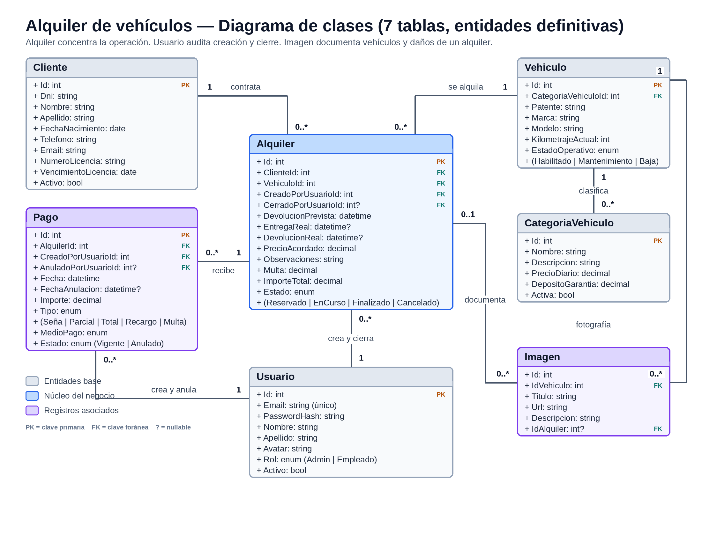

# 🚗 DriveControl - Sistema de Gestión de Alquiler de Vehículos

> **Sistema Web de Uso Interno Exclusivo** para la administración integral de los alquileres de una agencia de vehículos. Permite gestionar clientes, flota, categorías, reservas, cobros y auditoría interna.

---

## 🔑 Credenciales de Acceso (Usuarios Seed)

Al ejecutar las migraciones e iniciar la aplicación por primera vez, el *seeder* (`Data/DatosIniciales.cs`) crea de forma automática e idempotente los siguientes usuarios de prueba:

|        Rol        |    Correo Electrónico       |   Contraseña   | Permisos Principales |
| :---------------- | :-------------------------- | :------------- | :------------------- |
| **Administrador** | `admin@drivecontrol.com`    |   `Admin123!`  | Acceso total: Usuarios, Vehículos, Categorías y Auditoría interna.|
|    **Empleado**   | `empleado@drivecontrol.com` | `Empleado123!` | Operaciones del día a día: Gestión de clientes, alquileres y pagos.|

*Nota: Los clientes no tienen acceso al sistema; toda la gestión es operada por el personal de la agencia.*

---

## 👥 Integrantes del Grupo (Grupo 11)

* **Evelyn Cetera** — [evelyncetera@gmail.com](mailto:evelyncetera@gmail.com)
* **Matias Correa** — [matigc90@gmail.com](mailto:matigc90@gmail.com)
* **Christian Villegas** — [villegaschristian16@gmail.com](mailto:villegaschristian16@gmail.com)
* **Mauricio Barca** — [mauriciobarca1989@gmail.com](mailto:mauriciobarca1989@gmail.com)

🔗 **Repositorio oficial:** [https://github.com/mgc90/alquiler-vehiculos-labo2-g11](https://github.com/mgc90/alquiler-vehiculos-labo2-g11)

---

## 🚀 Puesta en Marcha (Entorno Local)

### Requisitos Previos
* **.NET 10 SDK**
* **MySQL / MariaDB** ejecutándose en `localhost:3306`.
* **Herramienta Global de EF Core (`dotnet-ef`):** Necesaria para ejecutar las migraciones de Entity Framework Core. Si no la tienes instalada en tu equipo, ejecuta en la terminal:
  ```bash
  dotnet tool install --global dotnet-ef
  ```
  *(En caso de requerir actualización, puedes usar `dotnet tool update --global dotnet-ef`)*.

### Pasos para Ejecutar

1. **Clonar el repositorio:**
   ```bash
   git clone https://github.com/mgc90/alquiler-vehiculos-labo2-g11.git
   cd alquiler-vehiculos-labo2-g11
   ```

2. **Configurar Credenciales Locales (User Secrets):**
   Para evitar exponer credenciales o contraseñas locales en el repositorio remoto (`appsettings.json`), utilizamos el Administrador de Secretos de .NET:
   Si el proyecto todavía no tiene configurado un `UserSecretsId`,
   inicialízalo desde el directorio donde se encuentra el archivo
   `.csproj`:

   ``` bash
   dotnet user-secrets init
   ```

   A continuación, configura la cadena de conexión a tu base de datos:

   ``` bash
   dotnet user-secrets set "ConnectionStrings:DefaultConnection" "Server=localhost;Database=alquiler_vehiculos;User=root;Password=tu_contraseña;"
   ```
   *(Si tu usuario `root` local de MySQL no utiliza contraseña, puedes dejar `Password=;`)*.

3. **Crear la Base de Datos y Tablas:**
   ```bash
   dotnet ef database update
   ```

4. **Ejecutar la Aplicación:**
   ```bash
   dotnet run 
   ```
   Accede desde tu navegador a: [http://localhost:5119](http://localhost:5119)

---

## 🔐 Configuración y Uso de la Web API

El proyecto incorpora una **Web API REST autenticada mediante JWT (JSON
Web Token)**, independiente del mecanismo de autenticación por cookies
utilizado por la aplicación MVC.

La API permite consultar la disponibilidad de vehículos y el estado de
los alquileres. Sus endpoints protegidos requieren un token JWT válido y
un usuario con el rol correspondiente (`Administrador` o `Empleado`).

### 1. Configurar la clave JWT

Para utilizar la Web API es necesario configurar la clave de firma del
token, identificada como `Jwt:Key`.

Por razones de seguridad, esta clave no se encuentra almacenada en
`appsettings.json`. Debe configurarse localmente mediante User Secrets:

``` bash
dotnet user-secrets set "Jwt:Key" "REEMPLAZAR_POR_UNA_CLAVE_SEGURA"
```

La clave debe ser segura y mantenerse fuera del repositorio. No debe
compartirse ni publicarse.

Los demás parámetros de JWT ya se encuentran definidos en
`appsettings.json`:

  Parámetro                 Valor
  ------------------------- ------------------------
  `Jwt:Issuer`              `AlquilerVehiculos`
  `Jwt:Audience`            `AlquilerVehiculosApi`
  `Jwt:ExpirationMinutes`   `60`

### 2. Configuración en otros entornos

En entornos distintos del desarrollo local, como producción, la clave
JWT puede configurarse mediante una variable de entorno:

``` bash
Jwt__Key=REEMPLAZAR_POR_UNA_CLAVE_SEGURA
```

En la configuración de ASP.NET Core, los dos guiones bajos (`__`)
representan los dos puntos (`:`) utilizados en las claves de
configuración.

La clave debe proporcionarse mediante un mecanismo seguro de
configuración del entorno y nunca incorporarse al repositorio.

### 3. Acceso a Swagger

Con la aplicación en ejecución, la documentación interactiva de la Web
API está disponible en:

<http://localhost:5119/swagger>

Desde Swagger se pueden consultar los endpoints disponibles y realizar
solicitudes de prueba.

Para utilizar los endpoints protegidos:

1.  Ejecutar primero el endpoint `POST /api/auth/login`.
2.  Obtener el token JWT devuelto en la respuesta.
3.  Presionar el botón **Authorize** en Swagger.
4.  Ingresar el token obtenido.
5.  Ejecutar los endpoints protegidos.

Swagger utilizará el esquema Bearer para enviar el token en las
solicitudes.

### 4. Endpoints disponibles

  -------------------------------------------------------------------------------------
  Método            Endpoint                        Descripción       Autenticación
  ----------------- ------------------------------- ----------------- -----------------
  `POST`            `/api/auth/login`               Valida las        No requiere token
                                                    credenciales del  
                                                    usuario y         
                                                    devuelve un token 
                                                    JWT con sus       
                                                    roles.            

  `GET`             `/api/vehiculos/disponibles`    Consulta los      JWT Bearer
                                                    vehículos         
                                                    disponibles para  
                                                    un período        
                                                    determinado.      

  `GET`             `/api/alquileres/{id}/estado`   Consulta el       JWT Bearer
                                                    estado y las      
                                                    fechas relevantes 
                                                    de un alquiler.   
  -------------------------------------------------------------------------------------

**Consulta de disponibilidad**

El endpoint de vehículos disponibles admite los siguientes parámetros:

-   `entregaPrevista`: fecha y hora prevista de entrega.
-   `devolucionPrevista`: fecha y hora prevista de devolución.
-   `categoriaVehiculoId`: identificador de categoría (opcional).
-   `pagina`: número de página (opcional).
-   `alquilerExcluirId`: identificador de alquiler a excluir del cálculo
    (opcional).

**Inicio de sesión**

El endpoint `POST /api/auth/login` recibe las credenciales del usuario
mediante un cuerpo JSON:

``` json
{
  "email": "admin@drivecontrol.com",
  "password": "Admin123!"
}
```

Si las credenciales son válidas, devuelve el token JWT y la información
del usuario autenticado, incluyendo sus roles y la fecha de expiración
del token.

**Consulta del estado de un alquiler**

El endpoint `GET /api/alquileres/{id}/estado` requiere el identificador
del alquiler en la ruta. Si el registro existe, devuelve la información
de su estado y las fechas previstas y reales disponibles.

### 5. Pruebas mediante Postman

El proyecto incluye una colección de Postman para probar los endpoints
de la Web API:

`docs/postman/AlquilerVehiculos-API.postman_collection.json`

Para utilizarla:

1.  Abrir Postman e importar el archivo JSON de la colección.
2.  Configurar las credenciales locales de un usuario de prueba con rol
    `Administrador` o `Empleado`.
3.  Ejecutar la solicitud de login.
4.  La colección guarda automáticamente el token JWT recibido.
5.  Ejecutar las solicitudes de disponibilidad y consulta del estado del
    alquiler, que utilizan automáticamente el token guardado.

**Importante:** para probar la consulta del estado es necesario disponer
de un alquiler existente en la base de datos. Si se utiliza una base
recién creada, primero debe registrarse un alquiler desde la aplicación.

---


## 📌 Descripción de la Problemática y Solución

### Problemática
Las agencias que operan manualmente o mediante planillas descentralizadas sufren de:
* **Solapamiento de reservas:** Alquiler duplicado de unidades o asignación de vehículos en taller/mantenimiento.
* **Falta de inmutabilidad en cobros:** Dificultad para auditar dinero efectivamente ingresado contra deudas pendientes (multas, recargos o daños).
* **Deficiencia en auditoría:** Imposibilidad de saber qué empleado creó, finalizó o anuló un registro.
* **Descontrol de licencias:** Falta de validación sobre el estado y vencimiento de la licencia de conducir del cliente.

### Propuesta de Solución
Aplicación web desarrollada en **ASP.NET Core MVC** con:
* Control de disponibilidad en tiempo real.
* Autenticación basada en Roles mediante Cookies.
* Registro inmutable de pagos y trazabilidad de saldos.
* Auditoría integrada para Administradores.
* Documentación fotográfica (portadas de flota y registro de daños).

---

## 🛠️ Reglas de Negocio y Flujo Operativo

### 1. Usuarios y Roles
* **Empleado:** Crea y gestiona clientes, consulta disponibilidad, realiza reservas, procesa entregas/devoluciones y cobra pagos. Solo edita su propio perfil.
* **Administrador:** Además de las funciones del empleado, administra usuarios, categorías, catálogo de vehículos y consulta la auditoría del sistema.
* **Clientes:** Son registrados por los empleados (requiere DNI, datos de contacto y fecha de vencimiento de licencia vigente durante el periodo de alquiler).

### 2. Ciclo de Vida del Alquiler
1. **Consulta de Disponibilidad:** Verificación en tiempo real de vehículos habilitados sin solapamiento de fechas.
2. **Reserva (`Reservado`):** El precio diario de la categoría se congela al momento de reservar.
3. **Entrega (`EnCurso`):** Se registra la fecha y hora real de entrega del vehículo.
4. **Devolución (`Finalizado`):** Se registra la entrega real. Si hay retrasos o daños, los recargos se suman al saldo del alquiler. La unidad queda libre inmediatamente.
5. **Cancelación (`Cancelado`):** Se libera el vehículo. La seña abonada se pierde como penalización y se calcula la multa correspondiente.

### 3. Pagos e Inmutabilidad
* La tabla `Pago` representa estrictamente dinero ingresado.
* **Inmutabilidad:** Un pago registrado no se modifica. Si hubo un error, se marca como `Anulado` y se registra un nuevo pago.
* **Tipos de Pago:** Seña, Parcial, Saldo, Recargo y Multa.

---

## 🗄️ Modelo de Datos (Entidades)

📊 **Diagrama Entidad-Relación (DER):** [`diagram/ERD.png`](diagram/ERD.png)



* **Usuario:** `Id`, `Email`, `PasswordHash`, `Nombre`, `Apellido`, `Avatar`, `Rol`, `Activo`
* **Cliente:** `Id`, `Dni`, `Nombre`, `Apellido`, `FechaNacimiento`, `Telefono`, `Email`, `NumeroLicencia`, `VencimientoLicencia`, `Activo`
* **CategoriaVehiculo:** `Id`, `Nombre`, `Descripcion`, `PrecioDiario`, `DepositoGarantia`, `Activa`
* **Vehiculo:** `Id`, `CategoriaVehiculoId`, `Patente`, `Marca`, `Modelo`, `KilometrajeActual`, `EstadoOperativo` *(Habilitado / Mantenimiento / Baja)*
* **Alquiler:** `Id`, `ClienteId`, `VehiculoId`, `CreadoPorUsuarioId`, `CerradoPorUsuarioId`, `EntregaPrevista`, `DevolucionPrevista`, `EntregaReal`, `DevolucionReal`, `PrecioAcordado`, `Observaciones`, `Multa`, `ImporteTotal`, `Estado` *(Reservado / EnCurso / Finalizado / Cancelado)*
* **Pago:** `Id`, `AlquilerId`, `CreadoPorUsuarioId`, `AnuladoPorUsuarioId`, `Fecha`, `FechaAnulacion`, `Importe`, `Tipo`, `MedioPago`, `Estado` *(Vigente / Anulado)*
* **Imagen:** `Id`, `VehiculoId`, `Titulo`, `Url`, `Descripcion`, `AlquilerId` *(Opcional para registro de daños)*

---

## 📊 Matriz de Evidencias de Requerimientos Mínimos

| Requerimiento Mínimo | Estado | Enlace al Código / Controladores | Evidencia (Captura / GIF / Video) |
|---|:---:|---|---|
| **1. Modelo de Datos y Persistencia** — 6+ tablas, relación 1:N y entidad que depende de otras dos | ✅ Cumplido | [`Data/ApplicationDbContext.cs`](Data/ApplicationDbContext.cs) · [`Models/Alquiler.cs`](Models/Alquiler.cs) · [`Models/Imagen.cs`](Models/Imagen.cs) | [`diagram/ERD.png`](diagram/ERD.png) |
| **2. Seguridad, Autenticación y Roles** — login/logout, roles, función restringida y avatar | ✅ Cumplido | [`Controllers/AccesoController.cs`](Controllers/AccesoController.cs) · [`Controllers/PerfilController.cs`](Controllers/PerfilController.cs) · [`Program.cs`](Program.cs) · [`Controllers/UsuariosController.cs`](Controllers/UsuariosController.cs) | Captura del perfil con avatar y del “Acceso denegado” con rol Empleado *(pendiente)* |
| **3. Manejo de Archivos** — adicional al avatar | ✅ Cumplido | [`Controllers/ImagenesController.cs`](Controllers/ImagenesController.cs) (portadas) · [`Controllers/AlquileresController.cs`](Controllers/AlquileresController.cs) (fotos de daños) · [`Views/Alquileres/Devolver.cshtml`](Views/Alquileres/Devolver.cshtml) | GIF de subida de portada y de fotos de devolución *(pendiente)* |
| **4. Módulo SPA / AJAX con Vue.js** — ABM completo sin recargar | ✅ Cumplido | [`Views/Vehiculos/Index.cshtml`](Views/Vehiculos/Index.cshtml) · [`Controllers/VehiculosController.cs`](Controllers/VehiculosController.cs) | GIF del ABM de vehículos *(pendiente)* |
| **5. Paginado por Servidor** | ✅ Cumplido | [`Repositories/Paginacion.cs`](Repositories/Paginacion.cs) · [`Models/ResultadoPaginado.cs`](Models/ResultadoPaginado.cs) · [`Controllers/UsuariosController.cs`](Controllers/UsuariosController.cs) · [`Controllers/ClientesController.cs`](Controllers/ClientesController.cs) | Captura del inspector de red con `?pagina=2` y el `LIMIT/OFFSET` *(pendiente)* |
| **6. Búsqueda Asíncrona de Entidades Relacionadas** | ✅ Cumplido | [`Controllers/AlquileresController.cs`](Controllers/AlquileresController.cs) (`BuscarClientes`, `Disponibles`) · [`Views/Alquileres/NuevaReserva.cshtml`](Views/Alquileres/NuevaReserva.cshtml) | GIF buscando cliente/vehículo en el formulario de reserva *(pendiente)* |
| **7. Web API REST con JWT** | ✅ Cumplido | [`API/AuthController.cs`](API/AuthController.cs) · [`API/VehiculosController.cs`](API/VehiculosController.cs) · [`API/AlquileresController.cs`](API/AlquileresController.cs) · [`Program.cs`](Program.cs) | [`Colección Postman`](docs/postman/AlquilerVehiculos-API.postman_collection.json) + captura con Bearer Token *(pendiente)* |

**Nota sobre el paginado:** todos los listados principales lo usan (Clientes, Vehículos, Alquileres, Pagos, Usuarios, Informes y Auditoría). `Categorías` es la única tabla sin paginar, por ser una tabla maestra pequeña exceptuada por la consigna.

---

## 📊 Informes y Requerimientos Técnicos

### Informes Prioritarios
1. Listado de vehículos filtrado por estado operativo.
2. Listado de alquileres vigentes según rango de fechas.
3. Historial de pagos por alquiler con opción a registrar nuevos cobros.
4. Consulta de disponibilidad de vehículos por rango de fechas y categoría.

### Requerimientos Técnicos Adicionales
* **Servidor:** Paginado, filtrados y búsquedas dinámicas en desplegables resueltos 100% en el servidor.
* **AJAX / Vue.js:** Implementación de al menos un módulo/ABM completo (ej. Vehículos) utilizando Vue.js mediante peticiones AJAX.